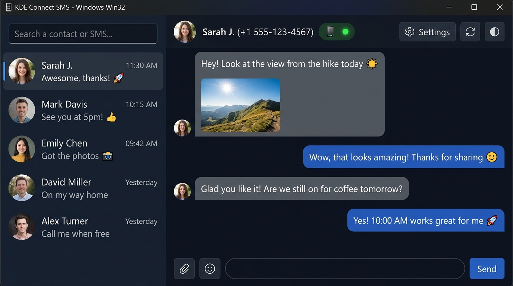
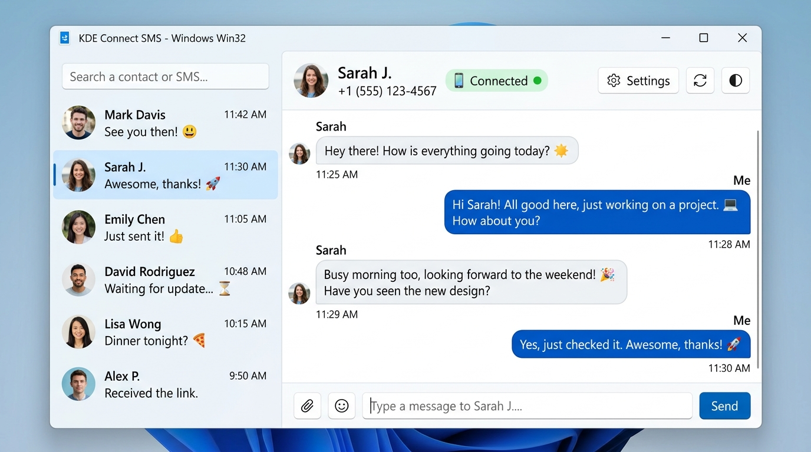
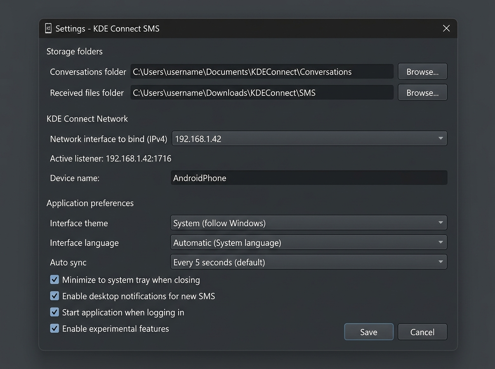

# KDE Connect SMS for Windows (Native Win32 C++)

A **fast, ultra-lightweight, pure native Win32 C++20** desktop client for **KDE Connect SMS** on Windows 10 and Windows 11.

Designed from the ground up using Microsoft's native **Win32**, **Direct2D**, **DirectWrite**, and **WIC** APIs—with **zero Qt, zero QML, zero Electron, and zero WebView2 bloat**—it launches instantaneously, uses a fraction of the memory, and looks and behaves like a first-class Windows application.

---

## Why Choose This Over the Official KDE Connect Qt App?

The official KDE Connect Windows build bundles the entire **Qt + QML + Kirigami + KDE Frameworks** runtime: dozens of DLLs, hundreds of megabytes on disk, sluggish startup, high memory usage, inconsistent Windows theming, and frequent Windows-specific UI/SMS sync bugs.

**KDE Connect SMS (Native Win32)** replaces all of that overhead with a single native C++ executable built directly against Windows system libraries:

| Feature / Metric | KDE Connect SMS (Native Win32) | Official KDE Connect (Qt / QML) |
| :--- | :--- | :--- |
| **Disk Footprint** | **~1–2 MB** standalone binary (~100× smaller) | **200–350+ MB** installed (Qt/QML/KF6 DLLs) |
| **Memory Usage (RAM)** | **~15–25 MB** hardware-accelerated | **150–300+ MB** |
| **Startup Time** | **Instant** (< 100 ms) | Several seconds |
| **Windows Integration** | Native Win32, DWM Dark Title Bar, Toast & System Tray | Cross-platform Qt/Kirigami widgets |
| **Dark / Light Theme** | Follows Windows 10/11 live (`WM_SETTINGCHANGE`), dark menus & dropdowns | Often mismatched or partial on Windows |
| **HiDPI Scaling** | Crisp Per-Monitor V2 DPI vector & DirectWrite rendering | Known Qt fractional scaling & blurriness issues |
| **Color Emojis & Input** | Full DirectWrite color emojis + native `Win + .` panel & built-in emoji menu | Partial/monochrome fallback issues |
| **Network Binding** | Pick the exact IPv4 network interface directly in Settings | Automatic/unconfigurable interface binding |

---

## Screenshots

### Windows 11 Dark Mode — Hardware-Accelerated Messaging & MMS


### Windows 11 Light Mode — Seamless Native Fluent Aesthetic


### Native Dark Mode Settings — Interface Binding, Folders & Languages


---

## Key Features

- **Hardware-Accelerated Direct2D & DirectWrite UI**: Silky-smooth scrolling, crisp anti-aliased chat bubbles, circular contact avatars, and full-color emoji rendering (`Segoe UI Emoji`).
- **Live Phone Connection Indicator**: Instant **green / red phone badge** in the top header with hover tooltip showing the connected phone's name and one-click manual sync/discovery refresh.
- **Native Windows 10 / 11 Integration**:
  - Automatic Light/Dark mode detection (`AppsUseLightTheme`) with live OS switching and immersive DWM dark title bars (`DWMWA_USE_IMMERSIVE_DARK_MODE`).
  - Modern Windows visual styles, dark-mode custom-painted Settings dropdowns, and system tray minimize/close support.
  - Native Windows Toast notifications with inline Quick Reply and tray balloon fallback.
  - Per-Monitor V2 DPI awareness for razor-sharp rendering on 4K and multi-monitor setups.
- **Full Emoji Support**: Insert emojis via the built-in Direct2D emoji picker menu **or** directly with Windows' native **`Win + .`** emoji panel (backed by `RichEdit50W`).
- **MMS Images, Videos & Accurate File Extensions**: Automatic magic-byte file type detection (`PNG`, `JPG`, `GIF`, `WebP`, `BMP`, `MP4`, etc.) with inline image previews and click-to-open video/media cards.
- **Multi-Language UI**: Automatically defaults to your Windows system language, with instant switching in Settings between **English**, **French**, **Spanish**, **German**, **Italian**, and **Portuguese**.
- **Clean Local Storage**:
  - Conversations stored as cleanly named JSON files by phone number (`<ConversationsFolder>`).
  - Contact avatars (`ContactAvatars/`), `contacts_cache.txt`, and `deleted_threads.txt` neatly organized inside your chosen conversations folder.
  - Separate configurable folder for downloaded MMS attachments.
- **Custom IPv4 Interface Binding**: Bind KDE Connect (UDP/TCP port `1716`) directly to a specific local network adapter (ideal when VPNs, virtual adapters, or multiple NICs are present).

---

## Building from Source

### Option 1: MinGW-w64 (`mingw32-make`) — Recommended

Prerequisites:
- Windows 10 (1809+) or Windows 11
- [MSYS2](https://www.msys2.org/) / MinGW-w64 `g++` (C++20) and `mingw32-make`

```cmd
mingw32-make KDEConnectSMS.exe
```

This outputs a single lightweight standalone executable: `KDEConnectSMS.exe`.

### Option 2: Visual Studio 2022 / MSVC

Open **x64 Native Tools Command Prompt for VS 2022** inside `cpp/`:

```cmd
cd cpp
build_msvc.bat
```

Or with CMake:

```cmd
cd cpp
cmake -B build -G "Visual Studio 17 2022" -A x64
cmake --build build --config Release
```

---

## Quick Start

1. Run **`KDEConnectSMS.exe`**.
2. On first launch, choose your preferred folder to store your SMS history, contacts cache, and avatars.
3. Make sure **KDE Connect** is installed on your Android phone on the same Wi-Fi/LAN network (if you use a VPN or multiple network adapters, select your LAN IPv4 address under **Settings -> Network interface to bind**).
4. Pair your phone when prompted and start texting directly from your Windows desktop.
