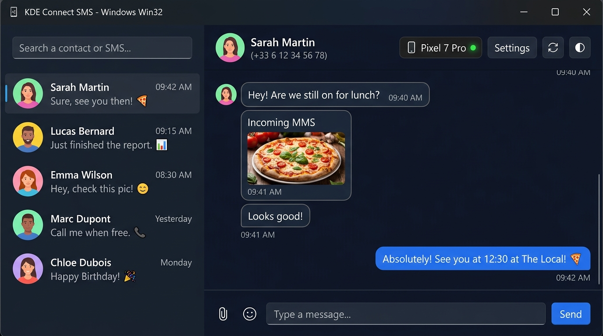
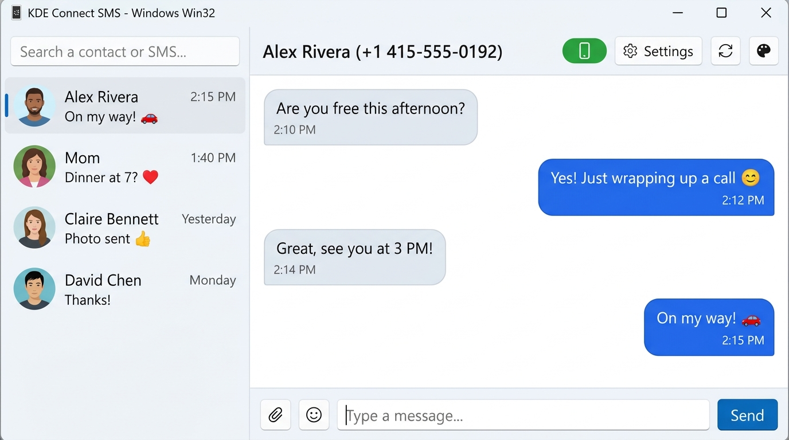
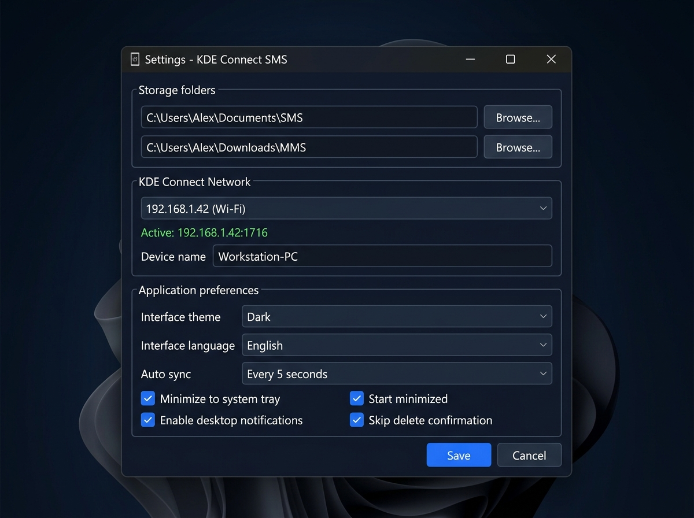

# KDE Connect SMS for Windows (Native Win32)

**A fast, ultra-lightweight native Windows desktop client for KDE Connect SMS & MMS — built in pure C++20, Win32, Direct2D, and DirectWrite.**

Tired of KDE's official Qt-based Windows port weighing **100× more**, eating hundreds of megabytes of RAM, shipping over a hundred Qt/KF6 DLLs, and breaking Windows styling and networking? **KDE Connect SMS** replaces all that bloat with a single, razor-sharp, hardware-accelerated native Windows executable that launches instantaneously and feels 100% built for Windows 10 & Windows 11.

---

## Screenshots

### Modern Dark Mode (Direct2D + Color Emojis + Inline MMS)


### Crisp Light Mode (Adaptive Windows Fluent Palette)


### Dark-Mode Settings & Network Interface Binding


---

## Why This Instead of the Official KDE Connect App?

The official KDE Connect Windows build relies on a massive Qt/QML/KDE Frameworks stack ported from Linux. While functional in theory, on Windows it suffers from heavy disk bloat, sluggish UI rendering, non-native controls, broken dark mode dialogs, and multi-adapter networking headaches.

| Feature | **KDE Connect SMS (Native Win32)** | **Official KDE Connect (Qt / QML)** |
| :--- | :--- | :--- |
| **Disk Footprint** | **Single ~1–2 MB `.exe`** (no runtime DLL pack) | **200–300+ MB** across 100+ Qt/KF6 DLLs (**~100× heavier**) |
| **Memory Usage** | **< 25 MB RAM** idle & active | **150–350+ MB RAM** |
| **Cold Startup** | **Instant (< 100 ms)** | Several seconds loading QML & plugins |
| **Rendering Engine** | **Hardware-accelerated Direct2D & DirectWrite (60 FPS)** | Software/Qt Quick QML scene graph |
| **Windows Dark/Light Mode** | **True native DWM (`DWMWA_USE_IMMERSIVE_DARK_MODE`)**, real-time `WM_SETTINGCHANGE`, custom owner-drawn dark dropdowns | Partial/inconsistent Qt styling, bright white native menus |
| **DPI & Fonts** | **Per-Monitor V2 DPI** aware + crisp `Segoe UI` & `Segoe UI Emoji` | Frequent blurry text or broken scaling on mixed monitors |
| **Emoji Input** | Native **`Win + .`** (RichEdit50W TSF) **and** built-in color emoji picker | Basic Qt text input with inconsistent Windows emoji panel support |
| **Network Binding** | **Pick exact IPv4 adapter (`BindIp`)** in Settings (great for VPNs/VMs/multi-NIC) | Frequently binds to the wrong virtual adapter |
| **Connection Visibility** | **Live Green / Red smartphone indicator** with hover device tooltip | Buried across sub-views / unreliable state updates |

---

## Key Features

### Native Windows 10 & 11 Integration
- **Adaptive Fluent Dark & Light Themes**: Follows your Windows `AppsUseLightTheme` setting automatically in real time—or switch instantly via the header toggle—including DWM dark title bars, dark scrollbars/edits, and custom dark-mode owner-drawn dropdowns.
- **Native Windows Toast Notifications & Quick Reply**: Receive incoming SMS alerts directly in the Windows Action Center and keep the app minimized cleanly in the **System Tray**.
- **Per-Monitor V2 High-DPI Scaling**: Razor-sharp vector chat bubbles, circular contact avatars, and typography on 4K and multi-monitor setups.

### Built for Speed, Media & Emojis
- **60 FPS Direct2D / DirectWrite Engine**: Hardware-accelerated message scrolling with smooth anti-aliased bubbles and full multi-color emoji rendering (`D2D1_DRAW_TEXT_OPTIONS_ENABLE_COLOR_FONT`).
- **Dual Emoji Workflow**: Press **`Win + .`** right inside the message box (powered by `RICHEDIT50W`) or open the built-in Direct2D color emoji picker.
- **Full MMS Photo & Video Support**: Native Windows Imaging Component (WIC) previews for JPEG, PNG, GIF, BMP, and WebP, automatic magic-byte file extension detection (so PNGs never save as `.jpg`), and click-to-open video attachments.

### Reliable Networking & Clean Local Storage
- **Live Green / Red Connection Indicator**: Instant visual status badge in the top bar showing whether your phone is currently connected over encrypted KDE Connect TLS (Protocol v8), with a hover tooltip displaying the connected device name and one-click refresh/broadcast.
- **Specific IPv4 Interface Binding (`BindIp`)**: Choose the exact Wi-Fi or Ethernet interface to bind UDP/TCP port `1716`—avoiding VPN, Docker, or Hyper-V virtual adapter conflicts.
- **Human-Friendly Local Backups**: Conversations are saved as phone-number-named JSON files inside your chosen folder alongside `ContactAvatars/`, `contacts_cache.txt`, and `deleted_threads.txt`. Settings live in a portable `KDEConnectSMS.ini` right next to the app.
- **Multi-Language Interface**: Automatically matches your Windows UI language at startup, with manual selection in Settings for **English**, **Français**, **Español**, **Deutsch**, **Italiano**, and **Português**.

---

## Building from Source

Zero external third-party libraries (no Qt, no Boost, no Electron, no WebView2)—links strictly against standard Windows system libraries (`d2d1`, `dwrite`, `windowscodecs`, `dwmapi`, `comctl32`, `ws2_32`, `crypt32`, `secur32`).

### Option 1: MinGW-w64 (Recommended)
```cmd
mingw32-make KDEConnectSMS.exe
```

### Option 2: Visual Studio 2022 / MSVC (`x64 Native Tools Command Prompt`)
```cmd
cd cpp
build_msvc.bat
```

### Option 3: CMake
```cmd
cd cpp
cmake -B build -G "Visual Studio 17 2022" -A x64
cmake --build build --config Release
```

---

## Requirements

- **OS**: Windows 10 (1809 or newer) or Windows 11 (x64)
- **Phone**: Official KDE Connect Android app on the same local network (UDP/TCP port `1716`)
